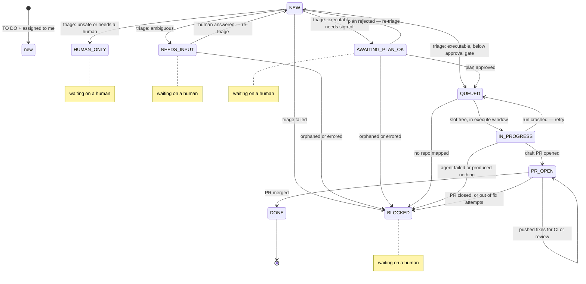

# ai-task-runner

A resumable bridge between a task manager and a coding agent. Ships with
ClickUp + Claude Code; swap either by implementing one small interface.

## Why it is built this way

Every tick advances each ticket **one step and exits**. Nothing blocks waiting
for CI or a human. That means a laptop closing, a VPN dropping or a crashed run
costs you at most one step, not a whole ticket.

## State machine

The transition table lives in `runner/graph.py` as data, not as `if` branches.
Illegal transitions raise instead of corrupting state, and this diagram is
generated from the same object the runtime uses, so it cannot drift:

```bash
ai-task-runner graph        # paste into Confluence / ClickUp docs
```



### Scheduling constraints

* **One agent per repo.** Two agents branching from the same base produce
  conflicting PRs. File-overlap detection sounds better but you don't know which
  files a ticket touches until after the agent has run, so the coarse rule is the
  useful one.
* **Blockers are honoured.** ClickUp task dependencies and Jira "is blocked by"
  links are read natively; a ticket with open upstream work is deferred with a
  comment rather than started.

## Multiple workspaces, providers and GitHub accounts

`sources` is the top-level unit: one task-manager workspace, its own credentials
and statuses, and the repos that belong to it. Mix ClickUp and Jira freely; each
source is ticked independently and a broken one never stops the others.

Repos reference a named `vcs_profile` for git/GitHub identity. Two mechanisms,
both parallel-safe:

| Mechanism | Config | When |
|---|---|---|
| PAT per account | `token_env: GH_TOKEN_ACME` | Simplest. Preferred. |
| Separate `gh` tree | `gh_config_dir: ~/.config/gh-acme` | You want `gh` interactively too |

Set up a second `gh` tree once:

```bash
GH_CONFIG_DIR=~/.config/gh-acme gh auth login
```

Do **not** use `gh auth switch` — it mutates global state and races between runs.
The profile also sets `GIT_SSH_COMMAND` and `GIT_AUTHOR_*`, so the right key is
used for push and commits are attributed to the right identity, regardless of
your global git config.

## Reassignment and multiple laptops

Each developer's SQLite is local, so the AI State field is the only shared state.
If a runner sees a ticket marked in-flight that it has no local record of — a
reassignment, or a second laptop — it does **not** adopt it. The branch, worktree
and PR live elsewhere. It marks the ticket `Blocked`, explains the handover in a
comment, and stops. Clearing the field re-triages from scratch.

## Install

```bash
pipx install -e .          # or: pip install -e .
cp config.example.yaml config.yaml
export CLICKUP_TOKEN=pk_xxx GH_TOKEN_WORK=ghp_xxx
gh auth login              # GitHub CLI, used for all PR operations
claude auth status         # each dev uses their own Claude login
ai-task-runner doctor      # checks every source, profile and repo
```

## Run

```bash
ai-task-runner run --dry-run --force        # see what it would do, right now
ai-task-runner run                          # one tick, respects time windows
ai-task-runner run --source acme            # limit to one workspace
ai-task-runner status                       # what is in flight, across sources
python3 tests_smoke.py                      # offline state-machine tests
```

## Schedule

One job every 15 minutes. Phase gating lives in `config.yaml`, not in cron.

**macOS / Linux**
```cron
*/15 * * * * cd /opt/ai-task-runner && /usr/local/bin/ai-task-runner run >> /var/log/ai-runner.log 2>&1
```

**Windows**
```powershell
schtasks /create /tn "ai-task-runner" /sc minute /mo 15 ^
  /tr "C:\Python312\Scripts\ai-task-runner.exe run -c C:\ai-runner\config.yaml"
```

**Anywhere** — if cron is awkward (laptop sleeps, Windows quirks):
```bash
ai-task-runner daemon --interval 900
```

## Rollout

1. **Weeks 1–2** — `mode: shadow`. Triage and comments only, no code. Measure how
   often engineers agree with the triage decision. If agreement is under ~80%,
   fix the prompt and the `ready` definition before going further.
2. **Week 3** — `mode: execute`, `max_active_tasks: 1`, `require_plan_approval_from_scope: xs`
   (everything needs a plan OK). One volunteer repo.
3. **Week 4+** — relax the approval gate to `m`, raise concurrency.

## Kill switch

Set `runner.mode: shadow`, or add the `no-ai` tag to any individual ticket.

## Adding a provider or agent

Implement `runner/providers/base.py::TaskProvider` (7 methods) and register it in
`runner/providers/__init__.py`, or implement `runner/agents/base.py::CodingAgent`
(2 methods). Nothing in `pipeline.py` knows about ClickUp, Jira or Claude Code.

### Jira specifics

State lives in an **issue entity property** (`ai-runner-state`) — no custom field,
no Jira admin, no screen configuration, atomic writes. Only the four states a
human must act on are mirrored to labels (`ai:needs-input`, `ai:human-only`,
`ai:plan-review`, `ai:blocked`), so boards stay readable.

One JQL trap the provider handles for you: `labels NOT IN ("no-ai")` silently
drops issues that have **no labels at all**. The `IS EMPTY` branch is required.

## Security notes

- `permission_mode: dontAsk` with an explicit `allowed_tools` allowlist, never
  `bypassPermissions` outside a disposable container.
- Worktrees live under `work_dir`, never in the developer's own checkout.
- Keep `.env` files out of the worktree; inject test config through the `setup`
  command instead.
- The denylist in `runner/triage.py` overrides the model. Nothing touching prod
  data, migrations, auth, payments, secrets or infra reaches the agent.
