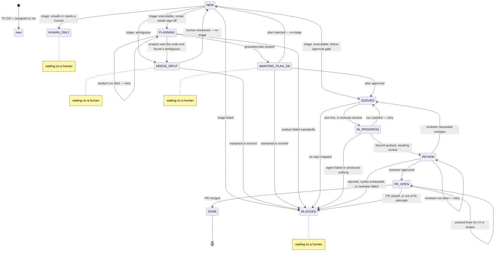

# deputy

A resumable bridge between a task manager and a coding agent. Ships with
ClickUp + Claude Code; swap either by implementing one small interface.

## Why it is built this way

Every tick advances each ticket **one step and exits**. Nothing blocks waiting
for CI or a human. That means a laptop closing, a VPN dropping or a crashed run
costs you at most one step, not a whole ticket.

## State machine

The transition table lives in `runner/graph.py` as data, not as `if` branches.
Illegal transitions raise instead of corrupting state, and this diagram is
generated from the same object the runtime uses, so it cannot drift:

```bash
deputy graph        # paste into Confluence / ClickUp docs
```



| State | Meaning |
|---|---|
| `new` | never triaged |
| `needs-input` | questions posted, waiting on a human answer |
| `human-only` | off-limits for the agent; a human does this one |
| `planning` | the analyst is reading the repo to ground a plan |
| `plan-review` | plan posted, waiting for a human OK |
| `queued` | approved, waiting for a free execution slot |
| `in-progress` | the agent is (or was) actively working in a worktree |
| `review` | branch pushed, an independent reviewer pass is judging it |
| `pr-open` | PR exists, polling CI and human review |
| `blocked` | escalated; needs a human |
| `done` | PR merged |

**Starting over.** Setting AI State back to `new` on a `human-only` or
`blocked` ticket makes the runner re-triage it from scratch on the next run. It
refuses (and says so, once) while a branch from the earlier attempt still
exists locally or on GitHub — delete it first. A ticket that is mid-flight on
this machine is never restarted by a remote `new`.

`planning` and `review` are the two stations added on top of the original
triage → execute → PR loop: `planning` runs a read-only analyst against the
repo before a human signs off on the plan, and `review` runs an independent
pass over the pushed branch before a PR ever opens.

### Scheduling constraints

* **One agent per repo.** Two agents branching from the same base produce
  conflicting PRs. File-overlap detection sounds better but you don't know which
  files a ticket touches until after the agent has run, so the coarse rule is the
  useful one.
* **Blockers are honoured.** ClickUp task dependencies and Jira "is blocked by"
  links are read natively; a ticket with open upstream work is deferred with a
  comment rather than started.

## Repo brain

Every repo gets a durable notes file — plain markdown at
`{runner.brain_dir}/{source}__{repo}.md` — holding the things a run learns
that would otherwise be relearned every tick: which env var the tests need,
which review finding keeps recurring. It is injected into the planner,
implementer and reviewer prompts as background context.

It is human-editable by design: open it, correct it, delete it. Nothing
treats it as anything other than a file. It is appended to only when the
independent review pass **approves** the change, before the PR is even
opened — a rejected, changes-requested, or crashed run writes nothing — and
appends are capped at `limits.brain_max_bytes`. At the cap, appends are
refused and logged rather than silently evicting older notes; prune it by
hand when that happens.

The other way in is a proposal you accept (see *Improvements*): a note drafted
from what keeps failing in the repo, written only when you run
`deputy improve accept`, through the same cap.

## Config keys added by the station release

| Key | Meaning |
|---|---|
| `runner.brain_dir` | where per-repo brain files live (see above) |
| `limits.brain_max_bytes` | per-repo brain file size cap |
| `limits.max_review_cycles` | implementer ↔ reviewer round trips before giving up and asking a human; separate from `max_fix_attempts`, which covers crashes and CI |
| `agent.reviewer_model` | model for the independent review pass; falls back to `agent.model` |
| `agent.planner_tools` | tools available to the analyst station; read-only by construction, which is what makes planning safe in `mode: shadow` |
| `agent.reviewer_tools` | tools available to the reviewer station; the repo's own `test` command is appended at call time |
| `limits.daily_tokens` | daily token ceiling; `0` (default) disables it. See *Two daily limits* below |
| `agent.max_log_bytes` | cap on one run's JSONL event log under `runner.log_dir` |
| `agent.triage_dir` | the empty directory triage runs in (default `~/.deputy/triage`) |
| `agent.isolate_triage` | `false` lets triage inherit the launch directory's context again |
| `runner.scorers_dir` | scorer files (see *Scorers*); default `~/.deputy/scorers`, absent means scoring is off |
| `runner.windows.score` | when scorers judge runs; defaults to the `triage` window |
| `limits.max_scores_per_run` | judge runs per tick, across all scorers (default 5) |
| `limits.score_lookback_days` | how far back unjudged runs are picked up (default 14) |
| `agent.scorer_model` | the judge's model unless a scorer names its own; falls back to `triage_model` |
| `runner.improve` | the improve station (see *Improvements*); `enabled: false` by default, plus its triggers and caps |
| `runner.windows.improve` | when the improve station runs; defaults to the `triage` window |
| `agent.improve_model` | the improve station's model; falls back to `agent.model` |

## Two daily limits, because dollars are the wrong unit

`claude -p` bills exactly like an interactive session — the auth decides, not the flag.
With a claude.ai login the runner spends your **5-hourly/weekly subscription quota**, and
the `total_cost_usd` the CLI reports is an API-*equivalent* price for work nobody is
actually invoiced for. Gating only on `daily_budget_usd` therefore limits notional money
while the constraint that really stops you — the quota — goes unmeasured.

So every run records tokens as well: input, output, cache-create and cache-read, summed.
`limits.daily_tokens` gates on that sum the same way `daily_budget_usd` gates on dollars.
Both are checked before *every* agent run, not just at the top of a tick, and whichever
trips first stops the tick with a message saying which.

To calibrate: a trivial one-turn run measured **40,156 tokens and $0.032** — the cache-read
tokens dominate. On a subscription the dollar limit will essentially never fire on its own,
so if you want a real ceiling, set `daily_tokens`. On an `ANTHROPIC_API_KEY` the dollar
figure is the true one and you can leave `daily_tokens: 0`.

`deputy status` prints both per row.

## Triage does not read your repos — now actually

Triage is meant to classify a ticket from its text alone. It used to run with no working
directory of its own, which meant it inherited whatever directory you launched the runner
from — and `claude` loads that directory's `CLAUDE.md`, settings, skills, MCP tool
definitions and git state into the system prompt before it reads a word of your prompt.
`--allowedTools ""` stops the model *acting* on a repo; it never stopped it being handed
one.

Asked "what project is your working directory?", triage launched from this repo used to
recite this repo's `CLAUDE.md`. It now answers `NO PROJECT CONTEXT`.

Triage therefore runs in `agent.triage_dir` — a fixed empty directory — with MCP servers,
skills, settings sources and auto-memory switched off, and with Claude Code's default
agent system prompt replaced by a short one saying it only classifies tickets. It is
also offered no tools at all (`--tools ""`): `--allowedTools ""` only controls what runs
without asking, so on its own the model was still offered Bash, reached for it, and ran
out of its single turn with no answer. Fixed rather than a fresh temp directory so a
changing path cannot defeat the prompt cache. With all of it, the `doctor` canary costs
about 370 input tokens instead of ~31k, but the reason to do it is correctness, not cost.

`work()` is **not** isolated, deliberately: the target repository's own `CLAUDE.md` is
exactly the context the implementer, analyst and reviewer need.

Set `agent.isolate_triage: false` to go back to the old behaviour.

## What happens when a run is killed

Agent runs are supervised rather than simply waited on:

- The agent leads its own **process group**, and a timeout kills the group — SIGTERM, then
  SIGKILL. Python's own `subprocess` timeout kills only the process it launched, which
  leaves Claude Code's bash invocations, MCP servers and subagents alive, still holding the
  worktree and still spending quota. The group is also reaped on the normal exit path.
- Output is streamed to a **JSONL event log** under `runner.log_dir` as it is produced and
  flushed per event, so a run that is killed still leaves a readable record — and you can
  `tail -f` a run in flight. It is bounded by `agent.max_log_bytes`; at the cap it records
  that it stopped rather than dropping the file or stalling the agent.
- **stdin is closed.** `claude -p` reads a non-TTY stdin and appends it to the prompt, so
  an inherited stdin quietly feeds the agent whatever is on it — a pipe, a heredoc, or a
  terminal it then waits on forever. The prompt is passed in argv.
- The child gets a **sanitised environment**: inherited `GIT_DIR` / `GIT_WORK_TREE` /
  `GIT_INDEX_FILE` are stripped (they would silently point the agent's `git` at a different
  repository), and `DEPUTY_RUN_ID` is set so a nested agent can tell it is already
  inside a managed run.

## Credentials never reach a ticket

Escalation comments, `last_error` values and the event log all carry raw subprocess output,
and a ticket comment is permanent and workspace-visible. Everything on those paths is
scrubbed by `runner/redact.py`, which matches both credential *shapes* (`ghp_`,
`github_pat_`, `sk-ant-`, `ATATT`, `pk_N_`, bearer headers, and `user:pass@host` inside a
git remote URL) and the *exact values* of the tokens the runner injects — including a
custom `token_env: GH_TOKEN_ACME`, found by env var name.

Patterns are deliberately narrow. A greedy rule would eat branch names and SHAs, and an
unreadable escalation comment just sends you off to run the failing command by hand with
the same credentials.

## Multiple workspaces, providers and GitHub accounts

`sources` is the top-level unit: one task-manager workspace, its own credentials
and statuses, and the repos that belong to it. Mix ClickUp and Jira freely; each
source is ticked independently and a broken one never stops the others.

Repos reference a named `vcs_profile` for git/GitHub identity. Two mechanisms,
both parallel-safe:

| Mechanism | Config | When |
|---|---|---|
| PAT per account | `token_env: GH_TOKEN_ACME` | Simplest. Preferred. |
| Separate `gh` tree | `gh_config_dir: ~/.config/gh-acme` | You want `gh` interactively too |

Set up a second `gh` tree once:

```bash
GH_CONFIG_DIR=~/.config/gh-acme gh auth login
```

Do **not** use `gh auth switch` — it mutates global state and races between runs.
The profile also sets `GIT_SSH_COMMAND` and `GIT_AUTHOR_*`, so the right key is
used for push and commits are attributed to the right identity, regardless of
your global git config.

## One ticket, several repos

A ClickUp list usually maps to one repo. A Jira project routinely covers a backend
and a frontend with nothing in the ticket to tell them apart — so **triage routes**.
List every repo under the source with the same `containers:` value, and triage is
shown each one's `key`, `language` and `notes` and picks the ones that need a change:

```yaml
repos:
  - key: shop-api
    containers: ["EPD"]
    language: "Go 1.24 REST API"
    notes: "Endpoints, business rules, persistence, background jobs."
  - key: shop-web
    containers: ["EPD"]
    language: "Next.js 15 + React 19 + TypeScript"
    notes: "Pages, components, forms, client-side state, styling."
```

Routing is only as good as those two fields. They are the entire basis for the
decision — triage never reads the repo.

A feature that genuinely spans both gets **one row per repo**: separate branch,
worktree, PR, review cycle and brain file, advancing independently. What they share
is the ticket's single AI State field, which shows the **least advanced** of the rows
— so it reads `in-progress` while either repo still has work, and only reaches `done`
once both PRs have merged. A row that gets blocked or escalated outranks the other's
progress, so a problem in one repo surfaces immediately. Comments name their repo.

The provider's own workflow status (`done_status` and friends) is gated the same way:
the first PR to merge will not close the ticket while the second is still open.

Each repo costs one `max_active_tasks` slot, because each is a real agent run.

## Reassignment and multiple laptops

Each developer's SQLite is local, so the AI State field is the only shared state.
If a runner sees a ticket marked in-flight that it has no local record of — a
reassignment, or a second laptop — it does **not** adopt it. The branch, worktree
and PR live elsewhere. It marks the ticket `Blocked`, explains the handover in a
comment, and stops. Clearing the field re-triages from scratch.

## Install

Every machine that runs a tick needs all of these on `PATH`:

| Needs | Why | Check |
|---|---|---|
| Python ≥ 3.10 | the runner itself | `python3 -V` |
| `git` | worktrees, commits, push | `git --version` |
| `gh` | every PR operation | `gh --version` |
| `claude` | the coding agent | `claude --version` |
| `bash` | each repo's `setup:` runs as `bash -lc` | `bash --version` |
| each repo's own toolchain | `setup:` and `test:` really execute | `pnpm -v`, `go version`, … |

```bash
python3 -m venv .venv && .venv/bin/pip install -e .   # or: pipx install -e .
cp config.example.yaml config.yaml
export CLICKUP_TOKEN=pk_xxx GH_TOKEN_WORK=ghp_xxx
gh auth login              # or skip it and set GH_TOKEN_* per vcs_profile
claude auth status         # must report an authenticated identity
deputy doctor      # checks every source, profile and repo
```

A venv rather than a bare `pip install` because Debian/Ubuntu ship PEP 668
`externally-managed-environment` and will refuse the system-wide install.

`doctor` is the gate, not a formality: it validates the transition table, every
`vcs_profile`'s auth, every provider credential, the repo mapping, and — on a
ClickUp `custom_field` source — that every `AIState` has a dropdown option.
Schedule nothing until it exits 0.

## Run

```bash
deputy run --dry-run --force        # see what it would do, right now
deputy run                          # one tick, respects time windows
deputy run --source acme            # limit to one workspace
deputy status                       # what is in flight, across sources
deputy score NAME                   # try a scorer on the latest runs (see Scorers)
deputy improve list                 # brain notes proposed for you (see Improvements)
deputy bench triage --dry-run       # what a triage benchmark would replay (see Benchmarks)
deputy bench implement --dry-run    # ... and an implementation benchmark
python3 tests_smoke.py                      # offline state-machine tests
```

## Scorers

A scorer is a rubric that judges finished agent runs, so "is the implementer
getting better at running the tests" has a number instead of an impression.
Each one is a markdown file in `runner.scorers_dir` (default
`~/.deputy/scorers`): YAML frontmatter, then the rubric.

```markdown
---
name: implement-ran-tests        # defaults to the file name
stations: [implement, fix]       # any of plan, implement, review, fix
labels:                          # label -> score in 0..1, at least two
  ran_and_passed: 1
  ran_and_failed: 0
  did_not_run: 0
pass_score: 1                    # default: the best label's score
sample_rate: 100                 # % of runs judged; deterministic per run
# repos: [pulse-backend]         # default: every repo
# model: haiku                   # default: agent.scorer_model, then triage_model
---
Judge whether the agent ran the repository's tests after its last edit...
```

No directory, or no files in it, means scoring is off and costs nothing.
Four starters are in `examples/scorers/`. Try one against real runs before
you install it — nothing is recorded unless you ask:

```bash
deputy score examples/scorers/implement-ran-tests.md          # latest 3 runs
deputy score implement-ran-tests --run 412 --run 418          # ids from the Runs tab
deputy score implement-ran-tests --run 412 --record           # store it, as the tick would
```

Once a file is in place, each tick judges up to `limits.max_scores_per_run`
runs from the last `limits.score_lookback_days`, newest first, after triage
and inside the `score` window (default: the triage window). The judge is the
same tool-less, isolated one-turn call triage uses, with its own system
prompt; it reads a condensed transcript of the run from its log, plus the
plan and acceptance criteria the run was given, and never the repository.
Every judge run is budget-checked and on the ledger like any other agent run,
but it is not charged to the row: a PR's cost is the work, not the measuring.

Two labels are always available and never move a pass rate:
`insufficient_evidence` (the transcript does not show enough — including a
run too long to fit even with every message clipped, which is never judged
from half a transcript) and `error` (the judge failed or answered with a
label the scorer does not have). Failed runs are not judged; the Runs tab
already counts them. Triage leaves no transcript, so it cannot be scored yet.

`deputy doctor` lists the scorers it loaded and fails on a file it cannot
parse, since the tick only skips it with a warning.

## Improvements

Scorers say what went wrong; the improve station turns it into something the
next run is told. It reads one repo's recent failures (failed scorer verdicts,
and reviews that asked for changes or rejected the approach), checks them
against a read-only checkout of the base branch, and proposes at most one note
for the repo's brain, citing the failures it addresses. Nothing changes until
you accept it:

```bash
deputy improve run --repo pulse-backend    # one run now, whether or not it is due
deputy improve list                        # proposals waiting for you (--all: every run)
deputy improve show 7                      # the note, why, and the runs it cites
deputy improve accept 7                    # append it to the repo's brain
deputy improve reject 7 --reason "we moved to vitest"
```

It is off until `runner.improve.enabled: true`. Then, after scoring and inside
the `improve` window (default: the triage window), a repo is due once it has
`min_evidence` failures (5) that no earlier run has seen, or one that is
`max_age_days` old (7). Failures older than `lookback_days` (30) are not
evidence. At most `max_per_run` runs (1) happen per tick per source, each
budget-checked and on the ledger as its own kind, not charged to any row.

Each failure is shown to one run only, whatever came of it, so a quiet repo
costs nothing and a rejected idea is not re-derived from the same failures.
A rejected note and its reason are shown to every later run on the repo. A
run that fails spends no evidence; the tick leaves that repo alone for a day.
Accepting goes through the brain's size cap: at the cap nothing is written and
the proposal stays pending until you prune the brain and accept again.

## Benchmarks

Should triage run on haiku instead of sonnet? Would a stricter prompt ask
fewer pointless questions? A benchmark answers that with your own tickets
instead of a hunch. It replays past triage runs under each variant and grades
every call against what actually happened to the ticket:

| What happened next | The right call was |
|---|---|
| Triage said execute and every repo it chose merged | execute, to those repos |
| Triage asked a question and someone answered | clarify |
| Triage said human_only and someone set AI State back to `new` | anything but human_only |
| Triage said human_only and nobody reset it for a week | human_only |

Everything else is left out and counted, because history does not say what the
right call was: a question nobody answered, a ticket still in flight, an execute
that ended blocked or came back after a rejected plan. So is a ticket today's
denylist stops before the model sees it.

```bash
deputy bench triage --dry-run                  # the suite, the answer key, the estimated cost
deputy bench triage --model haiku              # the configured model and prompt, then haiku
deputy bench prompt > careful.md               # start a prompt variant from the built-in one
deputy bench triage --prompt careful.md        # ... and replay it on the configured model
deputy bench triage --model haiku --model opus --prompt builtin --prompt careful.md
deputy bench triage --current-repos            # offer today's repo notes, not the ones triage saw
deputy bench list                              # recent runs
deputy bench show 3                            # one run, and every call that disagreed with history
```

The configured triage model with the built-in prompt is always the first
variant, the baseline. `--model` and `--prompt` add every combination of the
ones you name. A prompt file replaces the classification instructions only;
the ticket, the repos and the comments are rendered exactly as triage
renders them, and the denylist, the override tag and the confidence and
scope checks apply as they do in the tick. A prompt is labelled with a hash of
its text, so an edited file shows up as a new variant.

The inputs are the snapshots triage keeps under `{runner.log_dir}/triage/`,
which hold the ticket as triage saw it, so replies written afterwards never
leak into the replay. Tickets triaged before snapshots existed cannot be
replayed; the suite grows as tickets finish.

For each variant you get accuracy against history with its 95% range and n,
routing accuracy on tickets that offered more than one repo, how often it
agreed with what triage decided at the time, failed calls (counted beside
accuracy, never in it) and the average cost and tokens per call. The
Benchmarks tab on the dashboard shows the same numbers.

It never runs in the tick. Each call is on the ledger, so it counts toward
the daily limits, which it respects, and `--max-usd` (default 5) stops it
from starting another triage run once that much is spent. Both are checked
between triage runs, never in the middle of one, so a stopped benchmark still
compares every variant on the same tickets. `--limit` (default 50) replays
the newest; `--repeat N` asks each variant N times per run.

### Implementation benchmark

Would opus write fewer changes the reviewer sends back than sonnet, and is
that worth three times the cost? `deputy bench implement` replays tickets
that merged: for each one it checks out the commit the branch started from
and runs the implementer again under each model, then grades what it wrote.

```bash
deputy bench implement --dry-run               # the suite and an estimate; runs nothing
deputy bench implement --model opus --limit 5  # the configured model, then opus, on the newest 5
deputy bench implement --repo pulse-backend    # only one repo's tickets
deputy bench implement --keep                  # keep the scratch clones under work_dir/bench
deputy bench show 7                            # one run, and every run graded wrong
```

A replay gets what the implementer got the first time: the tick's own
implement prompt and tools, the ticket as triage last saw it before the work
began, the agreed plan and acceptance criteria, and the repo's brain as it
stood that day. Notes dated on or after it are left out, since the approving
review of that very ticket may have written one. It runs in a scratch
repository under `{runner.work_dir}/bench/` that holds the base commit's
history and nothing else: no remote, and no branch, tag or later commit, so
the change that merged is not there to find. The runner pushes nothing from
it, and nothing is commented on or reviewed. It is not a sandbox: the replay
has the same tools as the implementer in the tick, which could still push to
a URL it was given, and its prompt tells it not to push, as there. The clone is deleted
afterwards; its diff and agent log stay under `{runner.log_dir}/bench/`.

Each run is graded twice:

- **Tests.** The repo's `test` command, run on the replay. These only count
  where the change that merged passes the same command in a scratch clone of
  its own. A suite that fails on the merged code on this machine (a missing
  service, an unbuilt dependency) cannot tell a good replay from a bad one.
- **A judge.** A tool-less model call that reads the ticket, the criteria,
  the plan, the merged diff and the replay's diff, and says `correct`,
  `partial` or `incorrect`. The merged diff is one right answer, not the only
  one. Diffs too big for one prompt are never cut: the verdict is
  `insufficient_evidence` and nothing is called. It uses `agent.scorer_model`
  unless you pass `--judge-model`.

A run is correct when the judge says so and the tests, where they ran,
passed. A run that changes nothing is wrong. A failed run, or a judge that
could not decide, is counted beside the rate, never in it.

A ticket can be replayed once it has a base commit, a PR number and the
triage snapshot that routed it, all recorded since the measurement release.
Its diff comes from `gh pr diff`, through the repo's vcs profile.

This is the expensive benchmark: every run is a full implementation. The
dry run's estimate is what each ticket's original implement run cost. The
`--max-usd` cap (default 10) is checked against that estimate before each
ticket, so a run stops before a ticket it expects to cross the cap. The daily
limits are checked before every agent run, as in the tick. A ticket that not
every variant finished is left out of the comparison. `--limit` defaults to 10.

## Dashboard

```bash
pip install -e '.[web]'
deputy serve            # http://127.0.0.1:8787
```

A read-only view of this laptop's runner: what is stuck, what is running,
what it cost, and whether the work landed. It opens the SQLite store with
`mode=ro`, so it cannot write to the database, the tickets or the repos —
acting on the runner stays in the task manager and the CLI.

| Tab | What it answers |
|---|---|
| Overview | What needs you, grouped: questions to answer, plans to approve, blocked rows, runs that need a look |
| Board | Every in-flight row by state |
| Flow | For merged PRs: median time to PR, PR to first human review, review to merge; the share of cycle time spent waiting on people; human touches; how many merged with no human fix or commit; median cost per PR by size (lines changed, as GitHub counts them at merge) |
| Runs | Every agent run: station, outcome, wall time, turns, the model that answered (⚠ when it differs from the one requested), tokens, cost; click one to open its log. `#id` is what `deputy score --run` takes |
| Scorers | Per scorer: pass rate with its 95% range and n, passed/failed, insufficient evidence and judge errors beside it, judging cost; pass rate by day; every verdict with the judge's reasoning, opening the run's log |
| Improvements | Proposed brain notes waiting for you, with the evidence they cite (each opens that run's log) and the commands to accept or reject them; the acceptance rate with its 95% range; runs that proposed nothing, and why |
| Benchmarks | Per `deputy bench` run. Triage: each variant's accuracy against history with its 95% range, next to its average cost per call; routing, agreement with the original call, failed calls and the models that answered; every call that disagreed with history, with its reasoning. Implement: each variant's correct rate with its 95% range, next to its average cost per run; tests passed, partial, incorrect and no-change runs, time and models; every run graded wrong, with its diff size and the judge's reasoning |
| Spend, Throughput | Tokens and dollars per station per day, with judging, improve and benchmark runs as one grey overhead band; outcomes and cycle times |
| Graph | The live state machine as a table |

The date range (7, 14, 30 or 90 days) applies to Flow, Runs, Scorers,
Improvements, Benchmarks, Spend and Throughput. A row's detail sheet shows its history as lanes on one time axis —
the state it was in, the PR milestones, one bar per agent run — above the same
history as a list.

Flow and Runs read telemetry the runner started recording in this version, so
rows that finished earlier show `—` for run times and an unknown autonomy
rather than a guess. Stage times come from ticks, so they are only as precise
as the cron interval.

Triage also keeps what it saw and what it decided, redacted, under
`{runner.log_dir}/triage/` — one JSON file per triage run. They are what
`deputy bench triage` replays, so pruning them shrinks the benchmark; prune
them by hand like any other log.

`serve` refuses to start against a missing or unusable database rather than
serving a dashboard full of zeros — those are indistinguishable from a runner
that ran and found nothing to do, which is exactly the ambiguity the
dashboard exists to remove. Run `deputy run` at least once first.

It binds loopback by default. `--host` accepts anything, and warns, because
the page carries ticket titles, PR URLs and error text.

To change the UI you need Node:

```bash
cd web && npm install && npm run dev    # proxies /api to :8787
cd web && npm run build                 # writes runner/web/static/, which is committed
```

## Schedule

One job every 15 minutes. Phase gating lives in `config.yaml`, not in the
scheduler, so the schedule itself is deliberately dumb.

**macOS / Linux** — through a wrapper, never a bare command. Cron gets a
near-empty environment and reads neither `.profile` nor `.bashrc`, so `claude`
and `gh` are off `PATH` and every `${VAR}` in `config.yaml` is unset:

```cron
*/15 * * * * $HOME/.deputy/run.sh run >> $HOME/.deputy/logs/cron.log 2>&1
```

The wrapper is in *Deploy on a VPS* below — it is identical on a laptop.

**Windows**
```powershell
schtasks /create /tn "deputy" /sc minute /mo 15 ^
  /tr "C:\Python312\Scripts\deputy.exe run -c C:\deputy\config.yaml"
```

**Anywhere** — if cron is awkward (laptop sleeps, Windows quirks):
```bash
deputy daemon --interval 900
```

On a Linux server, prefer a systemd timer over both — the next section.

## Deploy on a VPS

A server is the natural home for this: nothing sleeps, nothing closes, and the
time windows finally mean what they say. The runner itself does not change — it
is still tick-and-exit — but a headless box exposes every assumption a laptop
quietly satisfied: an interactive login, a populated `PATH`, your timezone, your
SSH agent, your shell profile. The steps below are in dependency order; the
table at the end is what each skipped step looks like when it fails.

**Run exactly one runner per source.** The AI State field is the only shared
state, so a second runner that meets a ticket marked in-flight with no local row
of its own will not adopt it: it marks it `blocked` and stops (see *Reassignment
and multiple laptops*). Before the VPS takes over, let the laptop finish or drain
whatever is in flight, then disable its schedule. Copying `state.db` over is the
only way to keep an already-moving ticket moving.

Sized for one runner: 2 vCPU, 4 GB RAM plus swap, and disk for a full checkout
*and* a worktree per active task per repo — `node_modules` twice over adds up.
Outbound 443 to `api.anthropic.com`, `github.com`, and your task manager
(`api.clickup.com` / `*.atlassian.net`); outbound 22 to `github.com` as well if
any `remote:` is an SSH URL.

### 1. A user of its own

```bash
sudo adduser --disabled-password --gecos "" deputy
sudo -u deputy -H bash -l
```

The agent runs each repo's `setup:` through `bash -lc` and holds `Write`/`Edit`
on the worktree. Give it its own account, never root.

### 2. Set the timezone

```bash
sudo timedatectl set-timezone Europe/Amsterdam   # yours, not the VPS default
```

`runner.days` and `runner.windows` are compared against naive local time. A VPS
left on UTC runs your 06:30 triage window at whatever 06:30 UTC is for you, and
`days:` rolls over at the wrong midnight.

### 3. Toolchain

```bash
sudo apt update && sudo apt install -y python3-venv git curl
# gh — from GitHub's own apt repo, the distro package lags badly
sudo apt install -y gh          # see cli.github.com for the keyring setup
# node, if any repo's setup:/test: needs it — system-wide, see step 7
curl -fsSL https://deb.nodesource.com/setup_22.x | sudo -E bash - && sudo apt install -y nodejs
# the agent
curl -fsSL https://claude.ai/install.sh | bash    # lands in ~/.local/bin/claude
```

### 4. Authenticate Claude headlessly

`claude auth login` wants a browser, which a VPS does not have. Two ways round it:

| | How | Bills |
|---|---|---|
| Subscription | run `claude setup-token` **on your laptop**, put the token in `CLAUDE_CODE_OAUTH_TOKEN` on the VPS | your 5-hourly/weekly quota, competing with your own Claude Code use |
| API credits | `ANTHROPIC_API_KEY` + `CLAUDE_CODE_SIMPLE=1` | pay-as-you-go, and `limits.daily_budget_usd` finally gates real money |

`doctor` warns when `ANTHROPIC_API_KEY` is unset for exactly this reason: on
subscription auth the `total_cost_usd` the CLI reports is an API-*equivalent*
number, so the budget limit is gating spend nobody pays while the real
constraint — your quota — goes untracked. `CLAUDE_CODE_SIMPLE=1` makes a missing
key fail loudly instead of silently falling back to the subscription.

### 5. Git identities

Each `vcs_profile` needs its credentials present on the VPS:

* `token_env:` — mint a PAT (scope `repo`) for that GitHub account and export it.
  This is what `gh pr create` uses. Never `gh auth switch`: it mutates global
  state and races.
* `ssh_key:` — copy the private key over, `chmod 600`, and copy any matching
  `Host` block from your laptop's `~/.ssh/config`. `profile_env()` sets
  `GIT_SSH_COMMAND` with `IdentitiesOnly=yes` and
  `StrictHostKeyChecking=accept-new`, so first contact needs no `known_hosts`
  seeding — but a remote written against an SSH alias
  (`git@github.com-acme:org/repo.git`) still resolves that alias through
  `~/.ssh/config`, and without the block the clone fails with a DNS error.

Verify each one before going further:

```bash
GIT_SSH_COMMAND="ssh -i ~/.ssh/id_ed25519_work -o IdentitiesOnly=yes" \
  ssh -T git@github.com          # must greet the account you expect
GH_TOKEN=$GH_TOKEN_WORK gh auth status
```

### 6. Config

```bash
sudo install -d -o deputy -g deputy /opt/deputy
git clone <this repo> /opt/deputy && cd /opt/deputy
python3 -m venv .venv && .venv/bin/pip install -e .
cp config.example.yaml config.yaml
```

These are per-machine, and silently wrong if you copy a laptop's `config.yaml`:

| Key | Why |
|---|---|
| `runner.id` | lease ownership; two machines sharing an id can steal each other's rows |
| `repos[].path` | `/Users/you/code/x` does not exist on Linux |
| `runner.work_dir`, `db_path`, `log_dir`, `brain_dir` | must live on a disk the service user owns |
| `runner.mode` | start at `shadow` on a new host, whatever the laptop was on |

### 7. Secrets, in a file the scheduler can read

```bash
install -m 700 -d ~/.deputy
cat > ~/.deputy/env <<'EOF'
CLICKUP_TOKEN=pk_xxx
JIRA_EMAIL=you@example.com
JIRA_TOKEN=xxx
GH_TOKEN_WORK=ghp_xxx
CLAUDE_CODE_OAUTH_TOKEN=xxx
EOF
chmod 600 ~/.deputy/env
```

`Config.load` raises on the first unset `${VAR}`, so a tick with a half-loaded
environment fails immediately rather than half-working — which is the good news:
the failure mode is loud. Note the file has no `export` keywords; systemd's
`EnvironmentFile=` parses `KEY=value` only and does not run a shell.

`bash -lc` — which is how each repo's `setup:` runs — sources `~/.profile`, and
on Debian `~/.bashrc` returns immediately for non-interactive shells. So a
`nvm`/`fnm` line living in `~/.bashrc` is invisible to the agent and
`pnpm install` dies with "command not found". Install node system-wide, or put
the `PATH` export in `~/.profile` above the interactive guard.

### 8. Prove it works before scheduling it

```bash
set -a; . ~/.deputy/env; set +a
cd /opt/deputy
.venv/bin/deputy doctor              # must exit 0
.venv/bin/deputy run --dry-run --force
.venv/bin/python3 tests_smoke.py             # offline state-machine tests
```

### 9. A systemd timer

Preferred over cron on a VPS: it takes the env file directly, it will not start
a second tick on top of one still running, and `journalctl` beats a stray log file.

`/etc/systemd/system/deputy.service`:

```ini
[Unit]
Description=deputy — one tick
Wants=network-online.target
After=network-online.target

[Service]
Type=oneshot
User=deputy
WorkingDirectory=/opt/deputy
EnvironmentFile=/home/deputy/.deputy/env
Environment=PATH=/home/deputy/.local/bin:/usr/local/bin:/usr/bin:/bin
ExecStart=/opt/deputy/.venv/bin/deputy run -c /opt/deputy/config.yaml
TimeoutStartSec=3600
```

`TimeoutStartSec` has to clear `limits.agent_timeout_minutes` (45 by default)
with room to spare — systemd's 90-second default would kill a tick in the middle
of an agent run. `PATH` is explicit because a unit inherits almost nothing:
without it `claude` is not found and `ClaudeCodeAgent.__init__` raises before any
work starts.

`/etc/systemd/system/deputy.timer`:

```ini
[Unit]
Description=deputy every 15 minutes

[Timer]
OnBootSec=5min
OnCalendar=*:0/15
Persistent=true
AccuracySec=1min

[Install]
WantedBy=timers.target
```

```bash
sudo systemctl daemon-reload
sudo systemctl enable --now deputy.timer
systemctl list-timers deputy.timer
sudo systemctl start --no-block deputy.service   # one tick, by hand
journalctl -u deputy -f
```

Cron instead, if you prefer it — but it needs a wrapper, because cron gets a
near-empty environment and reads neither `.profile` nor `.bashrc`:

```bash
#!/usr/bin/env bash
set -euo pipefail
export PATH="$HOME/.local/bin:/usr/local/bin:/usr/bin:/bin"
set -a; . "$HOME/.deputy/env"; set +a
cd /opt/deputy
exec /opt/deputy/.venv/bin/deputy "$@"
```

```cron
*/15 * * * * $HOME/.deputy/run.sh run >> $HOME/.deputy/logs/cron.log 2>&1
```

### 10. Keep an eye on it

```bash
set -a; . ~/.deputy/env; set +a           # `status` still loads config.yaml
/opt/deputy/.venv/bin/deputy status -c /opt/deputy/config.yaml
journalctl -u deputy --since today | grep '"lvl":"ERROR"'
du -sh ~/.deputy/work/*                   # worktrees are not free
```

Logs are JSON lines, one `runner.log` in `runner.log_dir` plus whatever the
scheduler captures. Rotate them — `/etc/logrotate.d/deputy` with `weekly`,
`rotate 8`, `compress`, `copytruncate` is enough. Nothing prunes worktrees except
the pipeline itself, so watch the disk for the first few weeks.

### What breaks first

| Symptom | Cause |
|---|---|
| `Config references unset env var CLICKUP_TOKEN` | the scheduler never saw your env file |
| `` `claude` not found on PATH `` | `~/.local/bin` missing from the unit's `PATH` |
| `doctor` reports `git`/`gh` missing | same, for a cron run without a wrapper |
| nothing happens, ever | VPS on UTC and `runner.windows` in your local time — or it is Saturday and `runner.days` excludes it |
| in-flight tickets all go to `blocked` on the first tick | they were started elsewhere and this host has no local row, so `_orphan()` refuses to adopt them — drain the old host first, or copy its `state.db` |
| two hosts fighting over the same row | both configs carry the same `runner.id`, so each satisfies the other's lease |
| `Permission denied (publickey)` on push | key not copied, wrong mode, or an SSH alias missing from `~/.ssh/config` |
| `pnpm: command not found` inside `setup:` | node installed via `nvm` in `~/.bashrc`, which `bash -lc` never reads |
| the unit is killed mid-run at 90s | `TimeoutStartSec` left at the systemd default |

## Rollout

1. **Weeks 1–2** — `mode: shadow`. Triage and comments only, no code. Measure how
   often engineers agree with the triage decision. If agreement is under ~80%,
   fix the prompt and the `ready` definition before going further.
2. **Week 3** — `mode: execute`, `max_active_tasks: 1`, `require_plan_approval_from_scope: xs`
   (everything needs a plan OK). One volunteer repo.
3. **Week 4+** — relax the approval gate to `m`, raise concurrency.

## Kill switch

Set `runner.mode: shadow`, or add the `no-ai` tag to any individual ticket.

## Upgrading

The station release (analyst + reviewer) added two `AIState` values, `planning`
and `review`. Auditing the ClickUp mapping for them also turned up a third,
pre-existing gap: `new` was never in `state_field_options:` either, even
though a rejected plan sends a ticket back to `new` via `set_ai_state`. On the
`custom_field` backend, `set_ai_state` raises the moment a ticket reaches a
state with no mapped dropdown option, so all three are hard failures, not
cosmetic gaps.

Before upgrading a ClickUp source on `custom_field`:

1. Create ClickUp dropdown options for `new`, `planning` and `review` on the
   AI State custom field.
2. Add all three to that source's `state_field_options:` in `config.yaml`.
3. Run `deputy doctor` and confirm no `RuntimeError` surfaces from
   the ClickUp provider.

Jira is unaffected — state lives in an issue entity property that accepts
any value, and only the four human-actionable states are mirrored to labels.

### From `ai-task-runner` to `deputy`

The rename changed local names only. Ticket-side identifiers are unchanged —
`<!-- ai-runner -->`, the ClickUp footer `🤖 posted by ai-task-runner`, the
`ai-runner-state` Jira property, `ai:*` labels, `ai-override` / `no-ai` — so
in-flight tickets carry on.

What did change: the CLI is `deputy`, the default data directory is
`~/.deputy`, and agents see `DEPUTY_RUN_ID` instead of `AI_TASK_RUNNER_RUN_ID`.
**Nothing falls back to `~/.ai-runner`.** Starting on an empty `~/.deputy`
means a fresh database, and every ticket that is in flight remotely gets
orphaned to `blocked`. So move the directory, don't just repoint config:

1. Stop the scheduler, or wait until no tick is running.
2. `mv ~/.ai-runner ~/.deputy`
3. Worktrees link to their repo by absolute path, so repair each one from
   its source repo: `git -C <repo path> worktree repair ~/.deputy/work/<repo key>/*`
4. Update `~/.ai-runner` paths in `config.yaml`, your wrapper script, `env` and
   the crontab / systemd unit. Reinstall (`pip install -e .`) to get the
   `deputy` console script.
5. `deputy doctor`, then `deputy status` — the in-flight rows should all be
   there — then re-enable the scheduler.

Hooks in a target repo that check `AI_TASK_RUNNER_RUN_ID` need updating too.

## Adding a provider or agent

Implement `runner/providers/base.py::TaskProvider` (7 methods) and register it in
`runner/providers/__init__.py`, or implement `runner/agents/base.py::CodingAgent`
(2 methods). Nothing in `pipeline.py` knows about ClickUp, Jira or Claude Code.

### Jira specifics

State lives in an **issue entity property** (`ai-runner-state`) — no custom field,
no Jira admin, no screen configuration, atomic writes. Only the four states a
human must act on are mirrored to labels (`ai:needs-input`, `ai:human-only`,
`ai:plan-review`, `ai:blocked`), so boards stay readable.

One JQL trap the provider handles for you: `labels NOT IN ("no-ai")` silently
drops issues that have **no labels at all**. The `IS EMPTY` branch is required.

`skip_labels` is the opt-out; `require_labels` is the opt-in. Set the latter and
the runner only triages issues carrying **all** of those labels — useful when a
non-engineer files the tickets and a developer breaks them into runner-sized
leaves by hand:

```yaml
require_labels: ["ai-ready"]
```

It gates `fetch_candidates()`, which feeds new triage only. In-flight tickets are
re-read by key each tick, so removing the label from a ticket the runner already
picked up will not strand it — add `no-ai` or unassign it to stop one mid-flight.

## Security notes

- `permission_mode: dontAsk` with an explicit `allowed_tools` allowlist, never
  `bypassPermissions` outside a disposable container.
- Worktrees live under `work_dir`, never in the developer's own checkout.
- Keep `.env` files out of the worktree; inject test config through the `setup`
  command instead.
- The denylist in `runner/triage.py` overrides the model. Nothing touching prod
  data, migrations, auth, payments, secrets or infra reaches the agent.
  The only way past it is a human: add the `policy.override_tag` tag
  (default `ai-override`; a label on Jira) and set AI State back to `new`. The
  denylist is then skipped for that ticket only, the model still judges it, and
  the plan always waits for approval whatever its scope.
